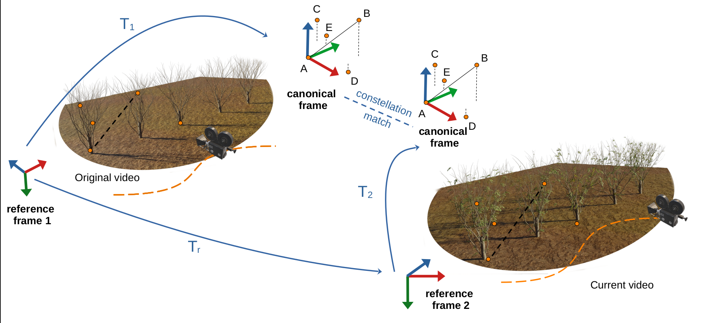
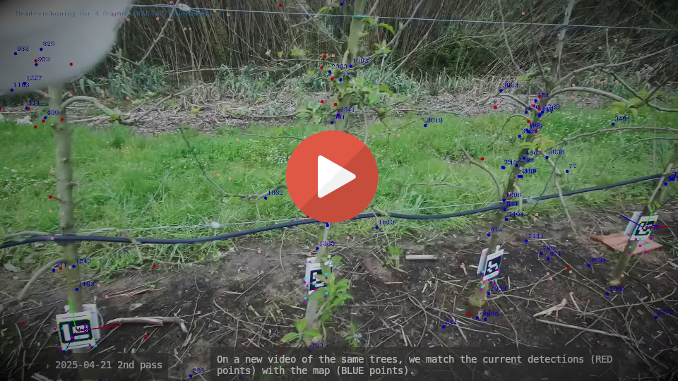

# Tree fingerprinting in the “season of the sticks”: mapping and visual localisation in orchards




This page contains the supplemental material associated to the paper with the same name, by Gonçalo P. Matos, José Ramos da Silva, Carlos Santiago, João P. Costeira, Ricardo L. Saldanha and Ernesto M. Morgado.


# What is it?

A geometric hashing system to fingerprint trees in an orchard, allowing for mapping and localisation in unstructured environments.


## Abstract

Accurate tracking of trees and their organs throughout the phenological cycle is of paramount importance in precision agriculture, enabling, among many tasks, optimised  harvesting and targeted disease detection. Artificial vision is a key technology to automate agricultural processes, however, mapping for visual navigation in orchards is, still today, a hard task due to its inherently dynamic structures and lack of stable visual cues.
Previous approaches relying largely on visual descriptors are susceptible to variations in illumination and rapid changes associated with plant growth, limiting their effectiveness in orchard environments. 
In this work we leverage geometric hashing principles that proved to successfully track fruits under such challenging conditions, and propose STaR-i HD, a hybrid geometric descriptor for ``constellations'' of tree structural elements, to close the gap towards the full mapping of orchards very early in the phenological cycle. In this phase, only trunks and branches are visible, so we also propose a definition of stable tree structures to track. 
We show that our method can re-identify the same trees and branches later in the year, and navigate in the orchard with centimetre-level precision using just a consumer RGB stereo camera.


# Video

[](https://anubis-sipg.isr.tecnico.ulisboa.pt/index.php/s/BtcdY7qCR5Y8oon)

# Dataset

The dataset is available for [browsing](https://anubis-sipg.isr.tecnico.ulisboa.pt/index.php/s/xPnsW9X6EbBzW2L) or [direct link](https://anubis-sipg.isr.tecnico.ulisboa.pt/public.php/dav/files/yd9TZ4CxfN8AWQ4/?accept=zip) (~20GB).


This dataset contains both real-world and synthetically generated videos.

Real-world videos cover several phenological stages of the same row of apple trees, approximately 15m long with 14 trees of the same species, throughout the year of 2025. 
These were collected in an apple orchard owned by [Instituto Nacional de Investigação Agrária e Veterinária (INIAV)](https://iniav.pt/), in Alcobaça, Portugal, handling a ZED 2i stereo camera while walking on foot, parallel to the row of trees and facing them at a distance of approximately 1.5m.

Synthetic videos were generated using the 3D modelling and animation software Blender and depict a set of 5 trees without leaves or fruits, shot with an approximately linear trajectory, but with different camera angles and starting positions.


# Cite

If you use this work or its dataset in your research, please cite:

```bibtex
@inproceedings{matos2026,
  title={Tree fingerprinting in the ``season of the sticks'': mapping and visual localisation in orchards},
  author={Matos, Gon\c{c}alo P and Silva, José Ramos and Santiago, Carlos and Costeira, João P. and Saldanha, Ricardo L. and Morgado, Ernesto M.},
  booktitle={Computer Vision--ECCV 2024 Workshop},
  pages={0--0},
  year={2026}
}

@article{matos2026stari,
title = {How to rewrite the stars: Mapping your orchard over time through constellations of fruits},
journal = {Computers and Electronics in Agriculture},
volume = {257},
pages = {112581},
year = {2027},
issn = {0168-1699},
doi = {https://doi.org/10.1016/j.compag.2026.112581},
url = {https://www.sciencedirect.com/science/article/pii/S0168169926011798},
author = {Gonçalo P. Matos and Carlos Santiago and João P. Costeira and Ricardo L. Saldanha and Ernesto M. Morgado}
}
```

and also acknowledge to Instituto Nacional de Investigação Agrária e Veterinária, I.P. (https://iniav.pt/).
